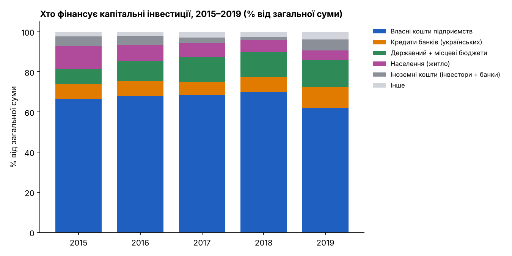
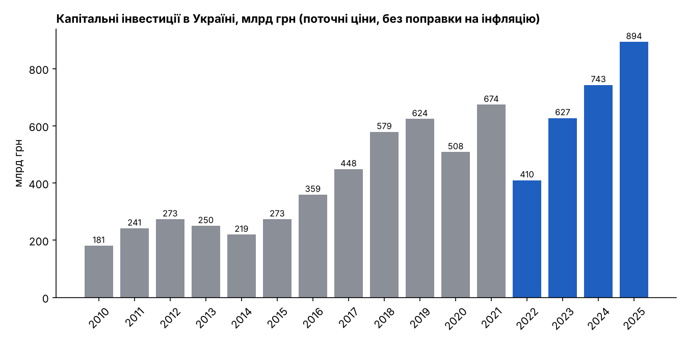
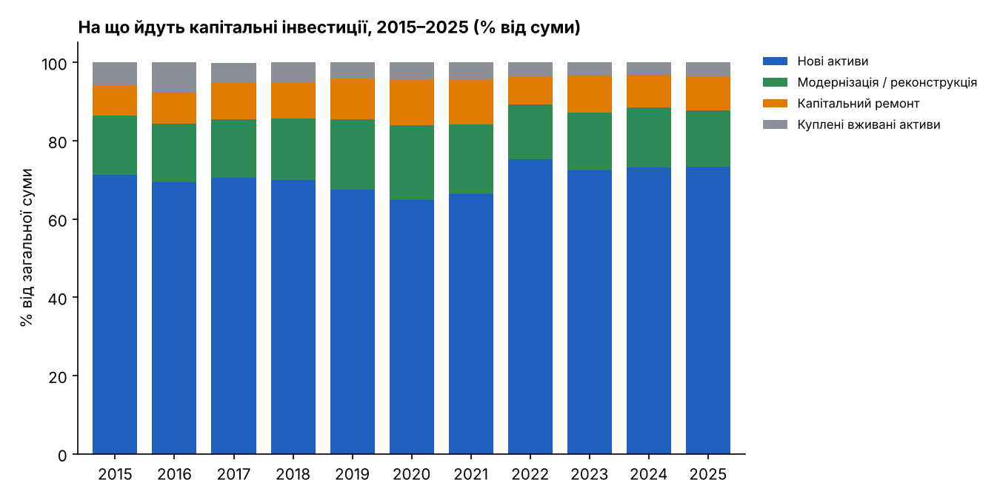
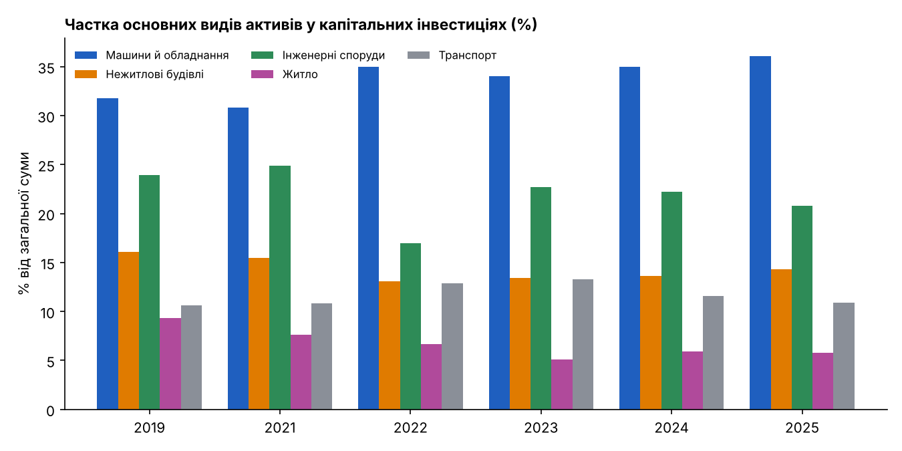
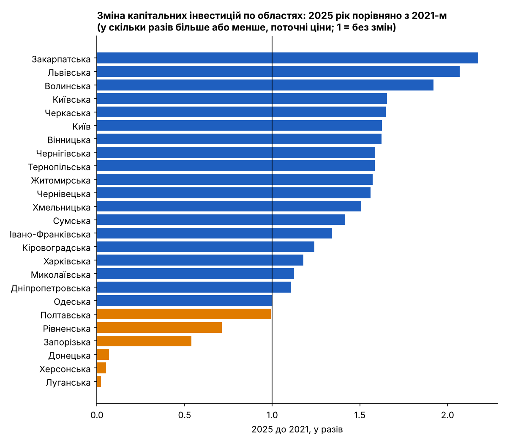

# Капітальні інвестиції в Україні: хто платить і на що йдуть гроші

Аналіз даних Державної служби статистики України (Держстат) про капітальні інвестиції у 2010–2025 роках.

## Питання дослідження
1. **Хто фінансував** капітальні інвестиції до війни (2015–2019)?
2. **На що йдуть** капітальні інвестиції у воєнні роки (2022–2025) порівняно з довоєнними?

## Джерело даних
- [Банк даних Держстату](https://stat.gov.ua/uk/explorer), набір «Капітальні інвестиції (річна)». Завантажено 05.11.2026.
- Сирий файл: `data/raw/capital_investments_raw.csv`. Вручну не змінювався: усі перетворення робить `analyze.py`.
- Суми у файлі в тисячах гривень, у скрипті переведені в мільярди.

## Як запустити
```bash
pip install -r requirements.txt
python analyze.py
```
Скрипт створює 5 графіків у `charts/` і проміжні таблиці у `data/`.

## Графіки

### Хто фінансував інвестиції до війни (2015–2019)


### Загальний обсяг (поточні ціни, без поправки на інфляцію)


### На що йдуть гроші: нові активи, модернізація, капремонт


### Які активи купують


### Зміна по областях: 2025 рік порівняно з 2021-м


## Основні результати

**1. До війни інвестиції здебільшого фінансував сам бізнес.** Власні кошти підприємств давали від 62,2% до 69,8% усіх інвестицій (66,4% у 2015 році, 62,2% у 2019-му). Частка державного й місцевих бюджетів разом зросла з 7,6% до 13,3%, а частка коштів населення на житло впала з 11,5% до 4,9%. Кредити українських банків становили 6,5–10,2%.

**2. Війна різко просадила інвестиції, але вони відновились у гривнях.** У 2022 році обсяг склав 410 млрд грн проти 674 млрд у 2021-му (мінус 39%). У 2025 році — 894 млрд грн, тобто на 33% більше за 2021 рік **у поточних цінах**.

**3. Структура витрат змістилась на нові активи.** Частка нових активів зросла з 66,4% (2021) до 75,2% (2022) і 73,3% (2025). Частка капітального ремонту впала з 11,5% до 7,2% у 2022 році, у 2025-му — 8,6%.

**4. Зростає частка обладнання.** Машини й обладнання: 30,8% (2021) → 36,1% (2025). Інженерні споруди: 24,9% → 20,8%, а в 2022 році було лише 17,0%.

**5. Області розійшлися.** Найбільше зростання у Закарпатській (у 2,18 раза), Львівській (2,07) і Волинській (1,92) областях. Найменше у Луганській (0,02), Херсонській (0,05) і Донецькій (0,07), але там дані не враховують тимчасово окуповані території, тож це не просто «інвестицій немає».

## Висновки
- Довоєнна модель трималась на коштах самих підприємств. Бюджет і кредити залишались другорядними джерелами.
- Дані **не дозволяють сказати, хто фінансує інвестиції під час війни**: розбивку за джерелами Держстат опублікував лише за 2015–2019 роки.
- Зростання у гривнях після 2022 року **ще не означає реального зростання**: дані в поточних цінах, а інфляція була значною.
- Дані показують зміщення до нових активів і обладнання, але причини цього з самих цифр не видно.

## Поради (обережні: дані показують «що», а не «чому»)
1. **Для Держстату й дослідників:** якщо вимоги безпеки дозволяють, відновити публікацію даних про джерела фінансування за воєнні роки. Без цього аналіз «хто платить» залишається довоєнним знімком.
2. **Для аналітиків:** перед будь-якими твердженнями про реальне зростання скоригувати суми на інфляцію (індекс споживчих цін також є в Банку даних Держстату).
3. **Для місцевої влади західних областей:** області з найбільшим зростанням можуть стати майданчиком для нових проєктів; варто перевірити, які галузі дали це зростання.
4. **Для бізнесу й політики:** якщо до війни два з трьох гривень інвестицій складали власні кошти підприємств, доступ до кредитів і гарантій є очевидним резервом збільшення інвестицій.
5. **Для регіонів із різким падінням** (наприклад, Рівненська, Запорізька): окремо з'ясувати причини, бо з цих даних вони не видні.

## Обмеження
- Усі суми в поточних цінах (номінальні).
- Дані 2010–2021 не враховують Крим, Севастополь і частину окупованих територій Донбасу; дані 2022–2025 не враховують території, окуповані росією, та частину територій, де ведуться (велися) бойові дії.
- Джерела фінансування є лише за 2015–2019; з 2019 року «кошти інвестиційних компаній» включено до «інших джерел».
- Частину даних Держстат не оприлюднює з міркувань статистичної конфіденційності.

## Наступні кроки
1. Додати індекс споживчих цін і порахувати реальні (скориговані) інвестиції.
2. Додати чисельність населення й порахувати інвестиції на одну особу по областях.
3. Показати зміну по областях на карті.
