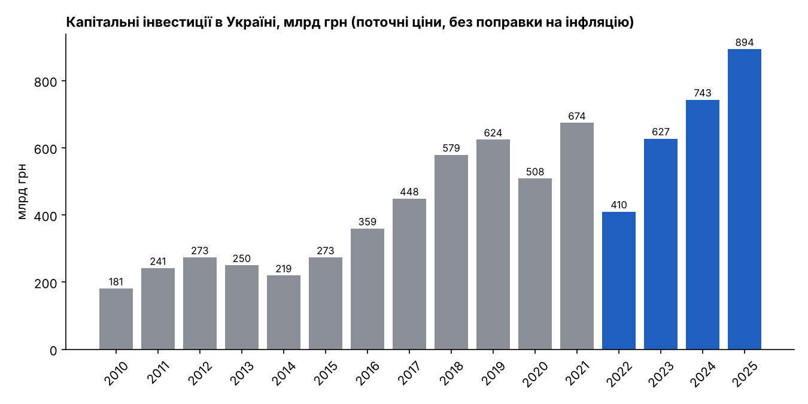
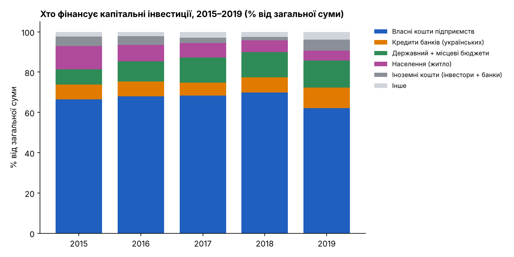
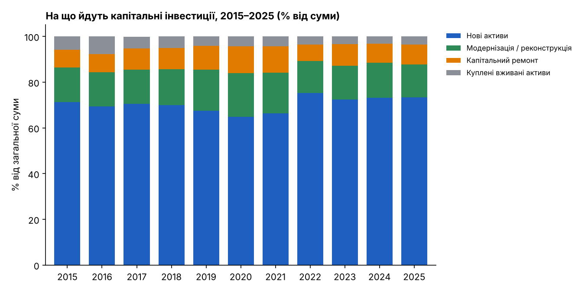
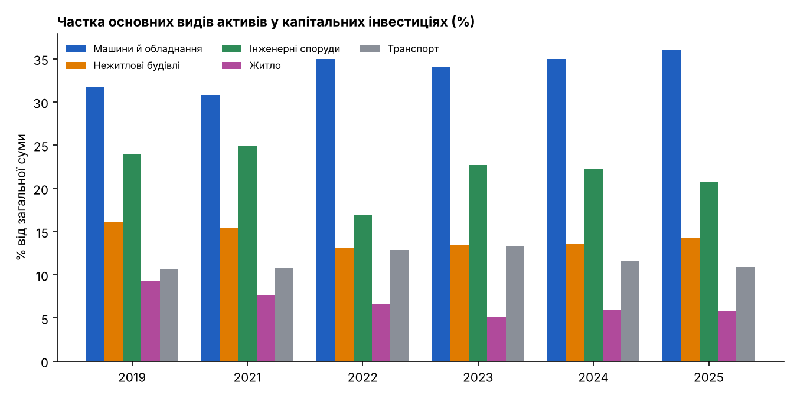
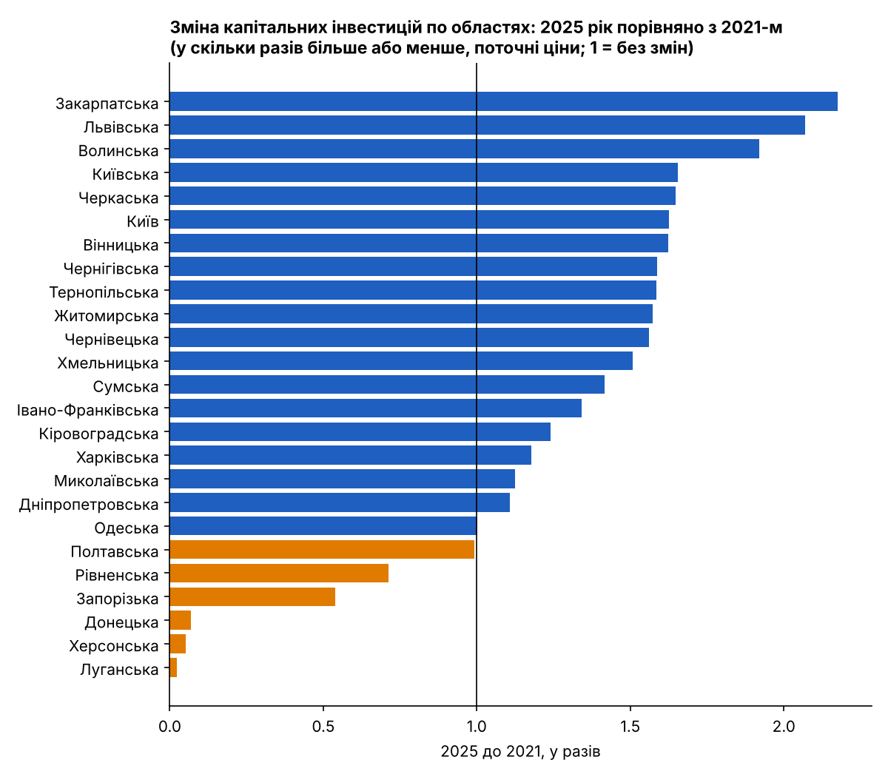

# Капітальні інвестиції в Україні: хто платить і на що йдуть гроші (2010–2025)

Аналіз даних Державної служби статистики України про капітальні інвестиції: хто фінансував інвестиції до війни і як змінилась їхня структура та географія у воєнні роки.

**Дані:** [Банк даних Держстату](https://stat.gov.ua/uk/explorer), набір «Капітальні інвестиції (річна)», завантажено 05.11.2026.
**Обробка:** Python (pandas, matplotlib), скрипт `analyze.py`.

## Методологія

- **Вхідні дані:** файл `data/raw/capital_investments_raw.csv` без ручних змін. Усі перетворення виконує скрипт.
- **Фільтри:** показник «Обсяг капітальних інвестицій», вид діяльності «Усього», територія «Україна» або окрема область.
- **Одиниці:** у файлі тисячі гривень, у результатах мільярди гривень. Усі суми в **поточних цінах**, без поправки на інфляцію.
- **Структура джерел** розраховувалась як частка кожного джерела в загальній сумі:

  $$Частка_i = \frac{S_i}{\sum S} \times 100\%$$

- **Зміна по областях** розраховувалась як відношення інвестицій 2025 року до 2021 року:

  $$K = \frac{I_{2025}}{I_{2021}}$$

  де $K > 1$ означає зростання у поточних цінах, а $K < 1$ означає скорочення.

## Ключові показники

- **Довоєнна структура:** у 2015–2019 роках власні кошти підприємств давали від 62,2% до 69,8% усіх капітальних інвестицій.
- **Роль бюджетів:** частка державного й місцевих бюджетів разом зросла з 7,6% (2015) до 13,3% (2019).
- **Падіння 2022 року:** обсяг інвестицій скоротився з 674 до 410 млрд грн, тобто на 39%.
- **Відновлення:** у 2025 році обсяг становив 894 млрд грн, на 33% більше, ніж у 2021-му, але у поточних цінах.
- **Структура витрат:** частка нових активів зросла з 66,4% (2021) до 73,3% (2025).

## Порівняльний аналіз: до війни і під час війни

### 1. Загальний обсяг інвестицій (млрд грн, поточні ціни)

*Суми номінальні: інфляція не враховувалась. Сірі стовпці: довоєнні роки, сині: воєнні (з 2022).*

- **2022 рік:** падіння на 39% відносно 2021-го (410 проти 674 млрд грн).
- **2023–2025:** 627, 743 і 894 млрд грн.

### 2. Джерела фінансування (лише 2015–2019)

- **Власні кошти підприємств:** 66,4% (2015), максимум 69,8% (2018), 62,2% (2019).
- **Бюджети (державний + місцеві):** 7,6% → 13,3%.
- **Кошти населення на житло:** 11,5% → 4,9%.
- **Кредити українських банків:** 6,5–10,2%, найвищий показник у 2019 році.
- **Іноземні кошти (інвестори + банки):** 4,6% (2015) → 1,7% (2018) → 5,6% (2019).

Розбивку за джерелами Держстат оприлюднив лише за ці п'ять років, тому для воєнного періоду висновків про джерела фінансування зробити неможливо.

### 3. На що витрачаються інвестиції

- **Нові активи:** 66,4% (2021) → 75,2% (2022) → 73,3% (2025).
- **Капітальний ремонт:** 11,5% (2021) → 7,2% (2022) → 8,6% (2025).
- **Модернізація та реконструкція:** 17,7% (2021) → 14,1% (2022) → 14,5% (2025).

### 4. Види активів

- **Машини й обладнання:** 30,8% (2021) → 36,1% (2025).
- **Інженерні споруди:** 24,9% (2021) → 17,0% (2022) → 20,8% (2025).
- **Житло:** 7,6% (2021) → 5,8% (2025).

### 5. Області: 2025 рік порівняно з 2021-м

- **Найбільше зростання:** Закарпатська (2,18), Львівська (2,07), Волинська (1,92).
- **Найбільше скорочення:** Луганська (0,02), Херсонська (0,05), Донецька (0,07), Запорізька (0,54), Рівненська (0,71).
- **Загальна картина:** 19 із 25 територій (24 області та Київ) перебувають на рівні 2021 року або вище.

Дані не охоплюють тимчасово окуповані території, тому низькі значення для Луганської, Херсонської та Донецької областей частково відображають обмеження збору даних.

## Загальні висновки за результатами аналізу

Аналіз капітальних інвестицій за 2010–2025 роки дозволяє зробити такі висновки:

- **Залежність від власних коштів бізнесу:** до війни дві третини інвестицій давали власні кошти підприємств. Бюджет і кредити були другорядними джерелами.
- **Прогалина в даних:** джерела фінансування за воєнні роки не опубліковані, тому питання «хто платить зараз» залишається відкритим.
- **Номінальне зростання:** збільшення з 674 до 894 млрд грн у поточних цінах ще не означає реального зростання, бо інфляція не враховувалась.
- **Зміщення до нових активів і обладнання:** частки нових активів і машин зросли, а частка капітального ремонту й інженерних споруд скоротилась. Причини з самих цифр не видно.
- **Регіональна нерівність:** західні області показують найбільше зростання, окуповані та прифронтові найменше, проте на частину цих значень впливає неповнота статистики.

### Обмеження
- Усі суми в поточних цінах.
- Дані 2010–2021 не враховують Крим, Севастополь і частину окупованих територій Донбасу. Дані 2022–2025 не враховують території, окуповані росією, та частину територій, де ведуться (велися) бойові дії.
- Частину даних Держстат не оприлюднює з міркувань конфіденційності.

