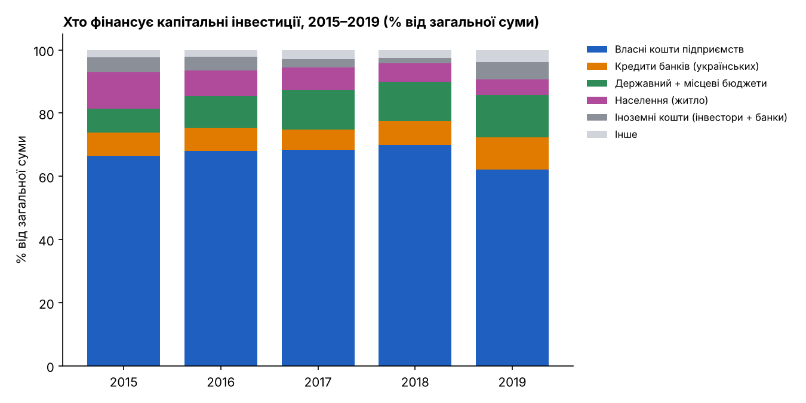
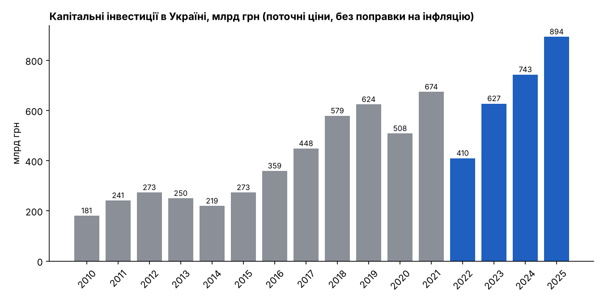
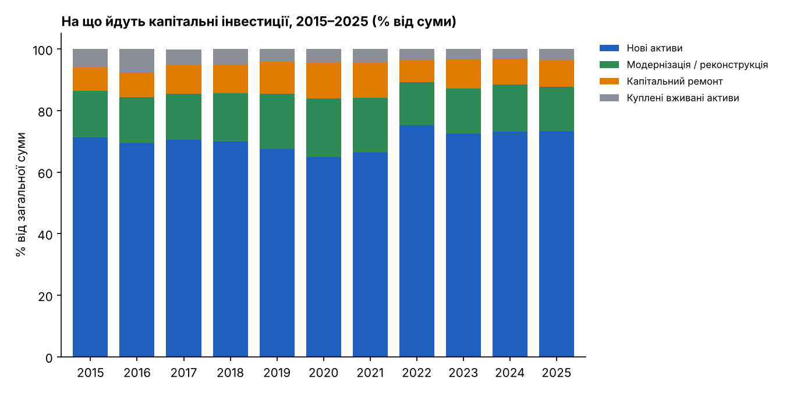
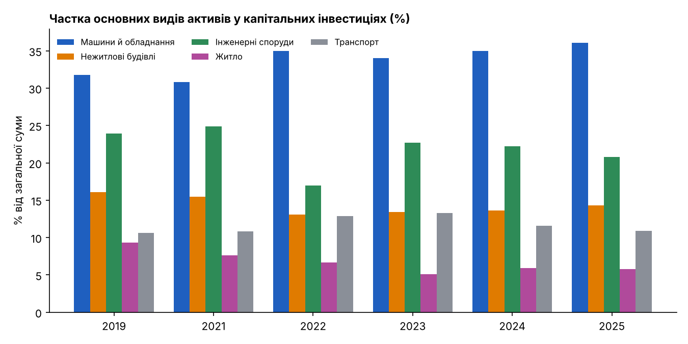
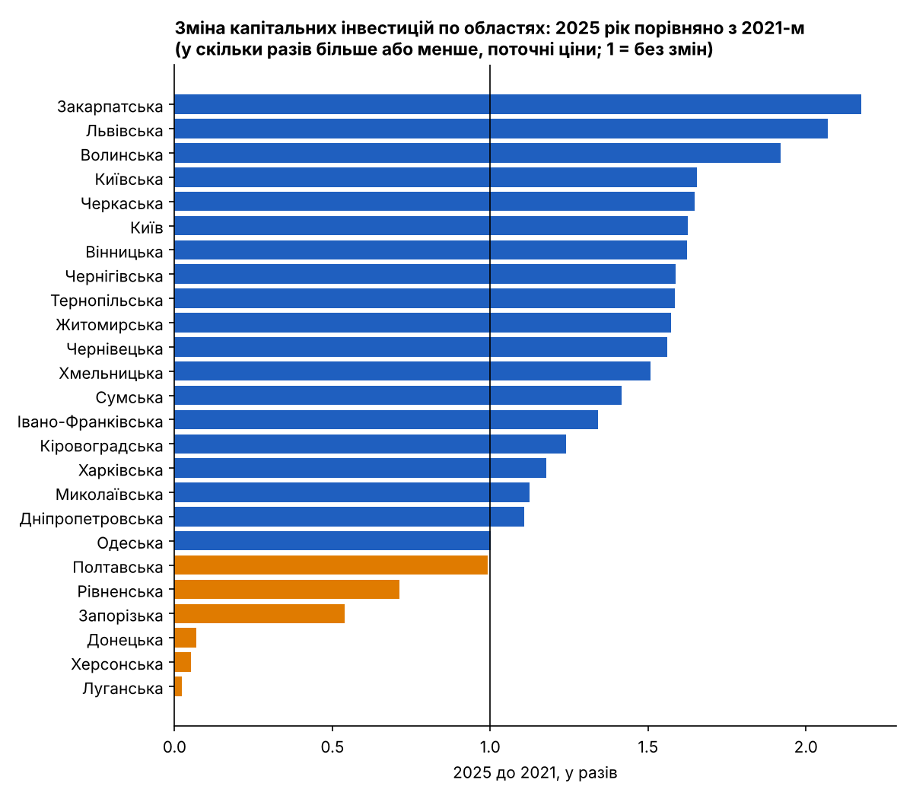

# Хто платить за відновлення: капітальні інвестиції в Україні до і під час війни

*5 листопада 2026*

Повномасштабна війна змінила не лише обсяг інвестицій в Україні, а й те, куди йдуть гроші. Аналіз даних [Державної служби статистики України](https://stat.gov.ua/uk/explorer) про капітальні інвестиції за 2010–2025 роки та авторської обробки в [GitHub-репозиторії дослідження](https://github.com/Cryptobeard7/ukraine-capital-investments) дозволяє побачити, на що спиралась інвестиційна активність до 2022 року і як її структура змінилася після.

Одразу варто назвати головну межу: розбивку інвестицій за джерелами фінансування Держстат опублікував лише за 2015–2019 роки. Тому відповісти на питання «хто платить» ми можемо тільки для довоєнного періоду. Для воєнних років дані показують інше: скільки вкладено, у що і в яких областях.

## До війни інвестиції тримались на власних коштах бізнесу

У 2015–2019 роках власні кошти підприємств і організацій давали від 62,2% до 69,8% усіх капітальних інвестицій. Пік припав на 2018 рік (69,8%), а у 2019-му частка впала до 62,2%.

*Джерело: Держстат, авторська обробка.*

Інші джерела відігравали другорядну роль, але їхня частка змінювалась помітно. Державний і місцеві бюджети разом збільшили частку з 7,6% у 2015 році до 13,3% у 2019-му. Кошти населення, спрямовані на будівництво житла, навпаки, скоротились з 11,5% до 4,9%. Кредити українських банків залишались у межах 6,5–10,2%, а найвищий показник зафіксовано саме у 2019 році.

Це не доводить, що саме бізнес був драйвером зростання. Але дозволяє припустити: довоєнні інвестиції здебільшого залежали від того, скільки готові були вкласти самі підприємства, а не від зовнішнього фінансування.

## Війна обвалила інвестиції, але гривневі обсяги відновились

У 2022 році обсяг капітальних інвестицій становив 410 млрд грн проти 674 млрд у 2021-му, тобто впав на 39%. Далі відбулося відновлення: 627 млрд у 2023-му, 743 млрд у 2024-му і 894 млрд грн у 2025-му. Це на 33% більше, ніж у 2021 році.

*Джерело: Держстат, авторська обробка. Суми у поточних цінах.*

Тут потрібне застереження. Усі суми наведені в поточних цінах, тобто без поправки на інфляцію. За цей період гривня суттєво знецінилась, тому у порівнянних цінах зростання виглядало б скромнішим. Наскільки саме, ми в цьому аналізі не рахували, а тому не стверджуємо, що реальні інвестиції перевищили довоєнний рівень.

## Дедалі більше грошей іде на нові активи й обладнання

Структура витрат змінилась. Частка нових активів зросла з 66,4% у 2021 році до 75,2% у 2022-му і залишилась високою: 73,3% у 2025-му. Натомість частка капітального ремонту впала з 11,5% до 7,2% у 2022 році, а в 2025-му становить 8,6%. Частка модернізації та реконструкції скоротилась з 17,7% до 14,5%.

*Джерело: Держстат, авторська обробка.*

Серед видів активів найпомітніше зростає частка машин і обладнання: з 30,8% у 2021 році до 36,1% у 2025-му. Частка інженерних споруд, навпаки, просіла з 24,9% до 20,8%, а у 2022 році опускалась до 17,0%. Житло скоротилось з 7,6% до 5,8%.

*Джерело: Держстат, авторська обробка.*

Дані не пояснюють причин. Можна припустити, що частина бізнесу вкладає в обладнання, яке легше замінити чи перемістити, ніж нерухомість, але це лише гіпотеза, яку цифри самі не підтверджують.

## Захід росте, схід і південь просідають

Порівняння 2025 і 2021 років по областях показує сильну нерівність. Найбільше зростання у поточних цінах зафіксовано в Закарпатській (у 2,18 раза), Львівській (у 2,07) і Волинській (у 1,92) областях. Загалом 19 із 25 територій (24 області та Київ) перебувають на рівні 2021 року або вище.

*Джерело: Держстат, авторська обробка. Значення 1 означає незмінний рівень.*

Найнижчі показники у Луганській (0,02), Херсонській (0,05) і Донецькій (0,07) областях, а також у Запорізькій (0,54) і Рівненській (0,71). Але читати цей графік спрощено не варто. Статистика не охоплює тимчасово окуповані території, тож для Луганщини, Херсонщини та Донеччини цифри відображають передусім обмеження збору даних, а не лише скорочення вкладень. Причини низького показника Рівненської області з цих даних не видно, тут потрібне окреме дослідження.

## Чого ці дані не показують

Ключових обмежень чотири:

- **Немає джерел фінансування за воєнні роки.** Тому ми не знаємо, чи змінилась роль бюджету, кредитів чи іноземних коштів після 2022 року.
- **Ціни поточні.** Реальне зростання потребує поправки на інфляцію.
- **Охоплення територій.** Дані не включають Крим і тимчасово окуповані території, а також частину територій, де ведуться або велись бойові дії.
- **Кореляція не є причиною.** Дані фіксують зміни, але не пояснюють їх.

## Що з цього випливає

Нижче не прогнози, а обережні висновки, які випливають із наявних цифр.

1. **Дані про джерела фінансування за воєнні роки були б корисними.** Якщо вимоги безпеки це дозволяють, їх публікація дала б змогу відповісти на питання, яке зараз залишається відкритим.
2. **Перед будь-якими заявами про «відновлення» потрібна поправка на інфляцію.** Індекс споживчих цін є в Банку даних Держстату, і це логічний наступний крок цього дослідження.
3. **Якщо до війни дві з трьох гривень інвестицій давали власні кошти підприємств, то доступ до кредитів і гарантій залишається очевидним резервом.** Це випливає з довоєнної структури, а не доведено для сьогодні.
4. **Областям із найбільшим зростанням варто з’ясувати, які галузі його забезпечили,** щоб підтримати вдалі проєкти. Областям із різким падінням потрібен окремий аналіз причин.

Ці висновки добре узгоджуються з логікою [Ukraine Plan](https://www.ukrainefacility.me.gov.ua/) на 2024–2027 роки в межах інструменту ЄС Ukraine Facility. За оцінкою Європейської комісії, цей план визначає реформи й інвестиції, що мають сприяти економічному зростанню та залученню інвестицій. Втім, наші дані не дозволяють оцінити, як саме він вплинув на структуру капітальних інвестицій.

---

**Візуалізації та обробка:** авторська обробка, [GitHub-репозиторій дослідження](https://github.com/Cryptobeard7/ukraine-capital-investments).

**Джерела та матеріали:** [Банк даних Держстату, набір «Капітальні інвестиції (річна)»](https://stat.gov.ua/uk/explorer), [Ukraine Facility Plan (Міністерство економіки України)](https://www.ukrainefacility.me.gov.ua/), [Ukraine Facility (Рада ЄС)](https://www.consilium.europa.eu/en/policies/ukraine-facility).
