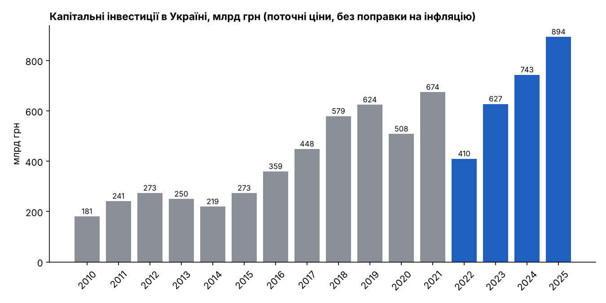
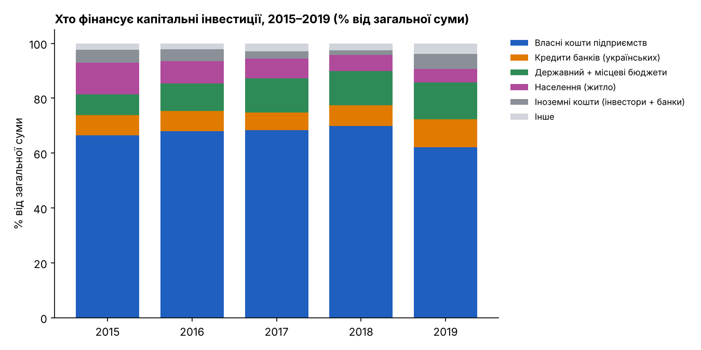
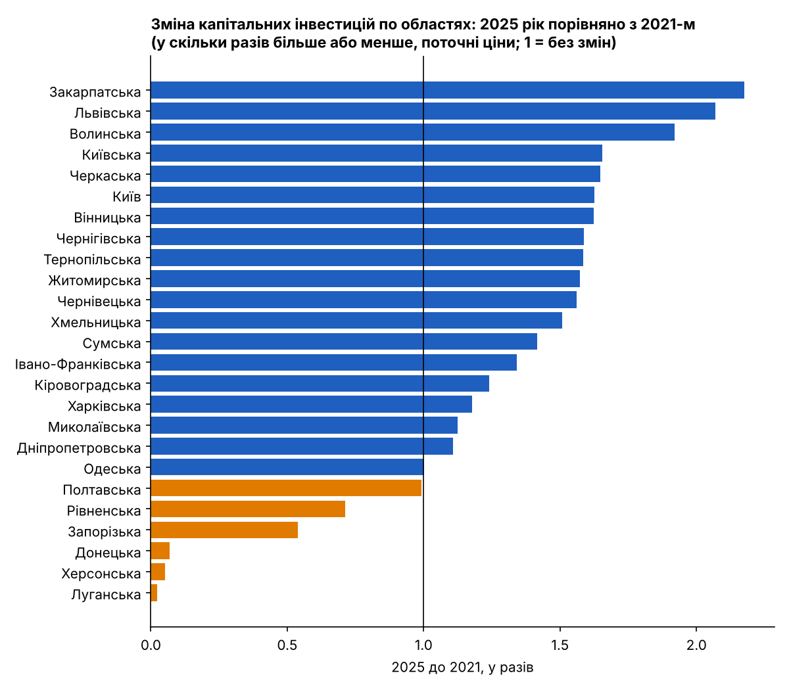

# Хто відбудовує Україну і за чий кошт: огляд гравців, грошей і прогалин у даних

*19 листопада 2026*

Відбудова України потребує сум, які в кілька разів перевищують річну економіку країни. Але хто саме розподіляє ці гроші, хто стежить за їхніми витратами, хто їх аналізує і звідки вони беруться? Цей огляд поєднує авторський аналіз [даних Державної служби статистики України](https://stat.gov.ua/uk/explorer) про капітальні інвестиції (обробка доступна в [GitHub-репозиторії дослідження](https://github.com/Cryptobeard7/ukraine-capital-investments)) з картою ключових організацій: від держави й громадських організацій до дослідників і міжнародних партнерів. В кінці ми адресуємо конкретним організаціям пропозиції, що випливають із наших даних.

## Масштаб потреб

За оцінкою Світового банку, ЄС та ООН (RDNA5), прямі збитки від війни станом на кінець 2025 року сягнули близько 195 млрд доларів, а потреби у відновленні й відбудові на найближчі десять років становлять майже 588 млрд доларів, тобто майже втричі більше за оцінений номінальний ВВП 2025 року ([Світовий банк](https://www.worldbank.org/en/news/press-release/2026/02/23/updated-ukraine-recovery-and-reconstruction-needs-assessment-released)).

На цьому тлі дані Держстату показують, що у 2025 році капітальні інвестиції в Україні становили 894 млрд грн у поточних цінах. Це на 33% більше, ніж у 2021 році, але без поправки на інфляцію.

*Джерело: Держстат, авторська обробка. Суми в поточних цінах.*

## Держава: хто розподіляє гроші

**Центральний рівень.** За даними відомчого сайту, за відновлення відповідає Міністерство розвитку громад та територій, а загальна стратегічна мета його плану на 2026 рік — відновлення й сталий розвиток громад, територій, транспорту та інфраструктури ([план діяльності](https://mininfra.gov.ua/storage/app/sites/1/uploaded-files/plan-diialnosti-minrozvitku-na-2026-rik.pdf)). Програми втілює [Агентство відновлення](https://restoration.gov.ua/), яке називає джерелами фінансування державний бюджет, міжнародні фінансові організації, грантові програми й технічну допомогу урядів-партнерів. Окремо працює [Фонд відновлення зруйнованого майна та інфраструктури](https://mininfra.gov.ua/diialnist/fond-vidnovlennia-zruinovanoho-maina-ta-infrastruktury): міжвідомча комісія розглядає звернення про розподіл його коштів.

**Регіональний рівень.** [Державний фонд регіонального розвитку](https://mininfra.gov.ua/news/derzhavnyi-fond-rehionalnoho-rozvytku) розподіляє кошти між регіонами за описом на сайті міністерства так: 70% залежно від чисельності населення і 30% залежно від податкоспроможності місцевих бюджетів. Обласні військові адміністрації подають звернення на кошти фонду відновлення, як це зробила Київська ОВА.

**Місцевий рівень.** Громади отримують субвенцію на проєкти відновлення: у програмі на 2026 рік уряд спершу розподілив 987,1 млн грн ([КМУ](https://www.kmu.gov.ua/news/blyzko-1-mlrd-otrymaiut-hromady-na-realizatsiiu-proektiv-vidnovlennia-rishennia-uriadu)), а потім обсяг фінансування збільшили майже до 2 млрд грн ([Київська ОВА](https://koda.gov.ua/minregion-gromady-otrymayut-dodatkovo-1-mlrd-grn-na-proyekty-vidnovlennya/)).

## Громадянське суспільство: хто стежить за витратами

Центральна роль тут у [Transparency International Ukraine](https://ti-ukraine.org/wp-content/uploads/2023/06/Gromadskyj-monitoryng-proektiv-vibudovy.pdf): організація розробила методику громадського оцінювання проєктів відбудови з чек-листом і алгоритмом дій, а також розвиває безкоштовний аналітичний інструмент BI Prozorro для аналізу відкритих даних закупівель. За власним звітом за 2023 рік вона запобігла порушенням у закупівлях на понад 500 млн грн.

Ще один гравець — коаліція RISE Ukraine. За даними Open Contracting Partnership, до неї входять 40 українських і міжнародних організацій, і саме вона рушійна сила [DREAM](https://euneighbourseast.eu/uk/projects/eu-project-page/?id=2178) — цифрової екосистеми управління відновленням, що веде відкриту базу проєктів і дає змогу відстежувати витрати. Сама [Open Contracting Partnership](https://www.open-contracting.org/worldwide/open-contracting-in-ukraine/) мобілізувала 1 млн доларів для організацій громадянського суспільства, зокрема TI Ukraine. Принципи відновлення, сформульовані коаліцією, використовує й [Центр економічної стратегії](https://ces.org.ua/wp-content/uploads/2023/11/mozhlivosti-ta-vikliki-zagalnih-princzipiv-vidnovlennya.pdf) як основу для моніторингу проєктів.

## Дослідники й конференції

Головний аналітичний центр у темі — [KSE Institute](https://institute.kse.ua/wp-content/uploads/2026/07/kse-institute_2025_annual-report_eng_july_2026.pdf) Київської школи економіки. Його [звіт про збитки станом на лютий 2026 року](https://institute.kse.ua/wp-content/uploads/2026/08/kse_institute_damages_report_2026_eng_august_2026.pdf) оцінює загальні збитки в 197,5 млрд доларів проти 169,8 млрд у попередній оцінці. Разом із Мінекономіки Інститут запустив Інвестиційний портал, у якому з липня 2023 року зібрано понад 1100 проєктів, а Ukraine Investment Guide описує 95 проєктів, що потребують близько 27 млрд доларів ([звіт 2024 року](https://kse.ua/wp-content/uploads/2025/09/KSE-Institute_2024_Annual-report.pdf)). У 2025 році, за його власним звітом, робота з відновлення змістилась від фіксації збитків до створення систем, потрібних для відновлення за стандартами ЄС, зокрема прозорих матриць відбору інвестицій. Інститут очолює Наталія Шаповал.

Найважливіший майданчик для обговорення — Ukraine Recovery Conference. Конференція 2026 року відбулась у Гданську 25–26 червня: на ній підписали 160 угод на понад 10 млрд євро, а окремо працював форум аналітичних центрів ([Recovery and Reform Delivery Office](https://rdo.in.ua/en/announce/ukraine-recovery-conference-urc-2026)). Наступну конференцію 2027 року прийматиме Таллінн ([CEMR](https://ccre-cemr.org/?p=32370)).

## Звідки гроші: ЄС і Світовий банк

**Європейський Союз.** Інструмент [Ukraine Facility](https://www.consilium.europa.eu/en/policies/ukraine-facility) передбачає до 50 млрд євро на 2024–2027 роки (33 млрд кредитами і 17 млрд грантами) за трьома напрямами: пряма фінансова підтримка (понад 38 млрд євро, умовна на виконання реформ Ukraine Plan), рамка інвестицій і програми допомоги. У липні 2026 року Рада додала до плану ще 8,3 млрд євро на 2026 рік ([Рада ЄС](https://www.eeas.europa.eu/delegations/ukraine/council-amends-ukraine-plan-reflect-more-eur8-billion-additional-ukraine-facility-financing-2026_en)). За документами ЄС, інвестиційна рамка має залучити до 40 млрд євро державних і приватних інвестицій; станом на липень 2026 року її зобов’язання сягнули 8,5 млрд євро, а очікуване залучення понад 25,7 млрд ([факт-лист ЄС](https://www.eeas.europa.eu/sites/default/files/2026/documents/Factsheet_-_EU_Solidarity_with_Ukraine_ENG.pdf)).

**Світовий банк.** З лютого 2022 року Україна отримала через механізми Банку понад 66 млрд доларів, майже 40 млрд з яких грантами ([Мінфін](https://www.kmu.gov.ua/en/news/serhii-marchenko-zustrivsia-z-keruiuchym-dyrektorom-svitovoho-banku-z-pytan-operatsiinoi-diialnosti-annoiu-bierde-z-2022-roku-ukraina-otrymala-ponad-66-mlrd-cherez-mekhanizmy-banku)). Головний інструмент — проєкт PEACE, загальне фінансування якого, за даними міністерства, наближається до 54 мільярдів доларів. Важлива деталь: за словами заступника міністра фінансів, ці кошти дозволили вчасно виплачувати зарплати вчителям, лікарям і держслужбовцям, пенсії та соціальні виплати ([Мінфін](https://www.kmu.gov.ua/en/news/minfin-ukraina-planuie-zaluchyty-200-mln-dolariv-ssha-hrantovoho-finansuvannia-u-mezhakh-proiektu-svitovoho-banku-peace)). Тобто значна частина підтримки йде на поточні витрати бюджету, а не на капітальні інвестиції, і це різні речі. Загалом, за підрахунками Світового банку, від лютого 2022 року для України залучено понад 89 млрд доларів фінансової підтримки ([Світовий банк](https://www.worldbank.org/en/country/ukraine/brief/world-bank-emergency-financing-package-for-ukraine)).

## Що показують наші дані й чого бракує

До війни капітальні інвестиції здебільшого фінансував бізнес: у 2015–2019 роках власні кошти підприємств давали від 62% до 70% усієї суми, а частка державного й місцевих бюджетів разом зросла з 7,6% до 13,3%.

*Джерело: Держстат, авторська обробка.*

Після 2022 року картина змінилась. У 2022 році інвестиції впали на 39%, а потім відновились у гривневому вимірі. Частка нових активів зросла з 66,4% (2021) до 73,3% (2025), а частка машин і обладнання з 30,8% до 36,1%. Регіони розійшлися: найбільше зростання у Закарпатській, Львівській і Волинській областях, найменше у прифронтових та окупованих, де статистика до того ж неповна.

*Джерело: Держстат, авторська обробка. Значення 1 означає незмінний рівень (поточні ціни).*

Головна прогалина: розбивку інвестицій за джерелами фінансування Держстат опублікував лише за 2015–2019 роки, тому відповісти на питання «хто платить зараз» за нашими даними неможливо. Тим часом загальний обсяг міжнародної підтримки відомий, але з нього не видно, яка частина стає капітальними інвестиціями, а яка йде на поточні витрати.

## Кому що пропонуємо

Нижче не прогнози, а пропозиції, які випливають з прогалин у наших даних. Усі вони потребують перевірки самими організаціями.

- **Держстат:** якщо вимоги безпеки дозволяють, опублікувати агреговану розбивку капітальних інвестицій за джерелами фінансування за 2020–2025 роки.
- **Мінрозвитку, Агентство відновлення, DREAM:** додати до відкритих даних про проєкти поле з джерелом фінансування, щоб можна було агрегувати його по областях.
- **Державний фонд регіонального розвитку:** перевірити, чи формула розподілу, що спирається на чисельність населення й податкоспроможність, враховує різні масштаби руйнувань, адже наші дані показують різкі відмінності між областями.
- **TI Ukraine і коаліція RISE:** використати BI Prozorro та DREAM, щоб зіставити проєктні дані з регіональною статистикою Держстату й пояснити різкі просідання, наприклад у Рівненській області.
- **KSE Institute:** зіставити дані Інвестиційного порталу з серією капітальних інвестицій Держстату та додати аналіз у порівнянних цінах, чого наш огляд не робить.
- **Європейська комісія, Світовий банк та інші партнери:** публікувати, яка частка залученої підтримки стає капітальними інвестиціями, а яка йде на поточні витрати.
- **Громадські організації:** вивчити умови грантового конкурсу ЄС на моніторинг відбудови соціальної інфраструктури ([EU Neighbours East](https://euneighbourseast.eu/uk/opportunities/monitoryng-vidbudovy-soczialnoyi-infrastruktury-v-ukrayini-grantovi-konkursy-dlya-gromadskyh-organizaczij/)); деталі умов ми не перевіряли.

## Обмеження

- Суми Держстату в поточних цінах, без поправки на інфляцію.
- Дані Держстату не охоплюють Крим і тимчасово окуповані території, а також частину територій, де ведуться або велися бойові дії.
- Дані про джерела фінансування є лише за 2015–2019 роки.
- Оцінки міжнародних організацій різняться за методологією, тому їх не можна напряму зіставляти з даними Держстату.
- Ми не перевіряли, чи є в DREAM і в Інвестиційному порталі дані про джерела фінансування кожного проєкту.

---

**Візуалізації та обробка:** авторська обробка, [GitHub-репозиторій дослідження](https://github.com/Cryptobeard7/ukraine-capital-investments).

**Ключові документи та матеріали:** [RDNA5 (Світовий банк)](https://www.worldbank.org/en/news/press-release/2026/02/23/updated-ukraine-recovery-and-reconstruction-needs-assessment-released), [Ukraine Facility (Рада ЄС)](https://www.consilium.europa.eu/en/policies/ukraine-facility), [Агентство відновлення](https://restoration.gov.ua/), [KSE Institute: звіт про збитки 2026](https://institute.kse.ua/wp-content/uploads/2026/08/kse_institute_damages_report_2026_eng_august_2026.pdf), [Transparency International Ukraine: методика моніторингу](https://ti-ukraine.org/wp-content/uploads/2023/06/Gromadskyj-monitoryng-proektiv-vibudovy.pdf), [Банк даних Держстату](https://stat.gov.ua/uk/explorer).
